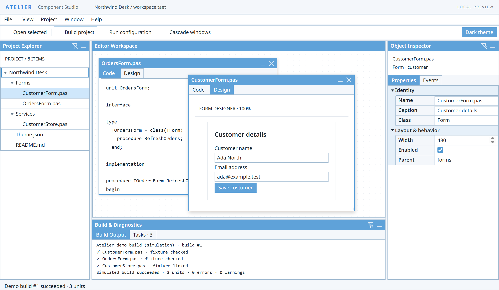
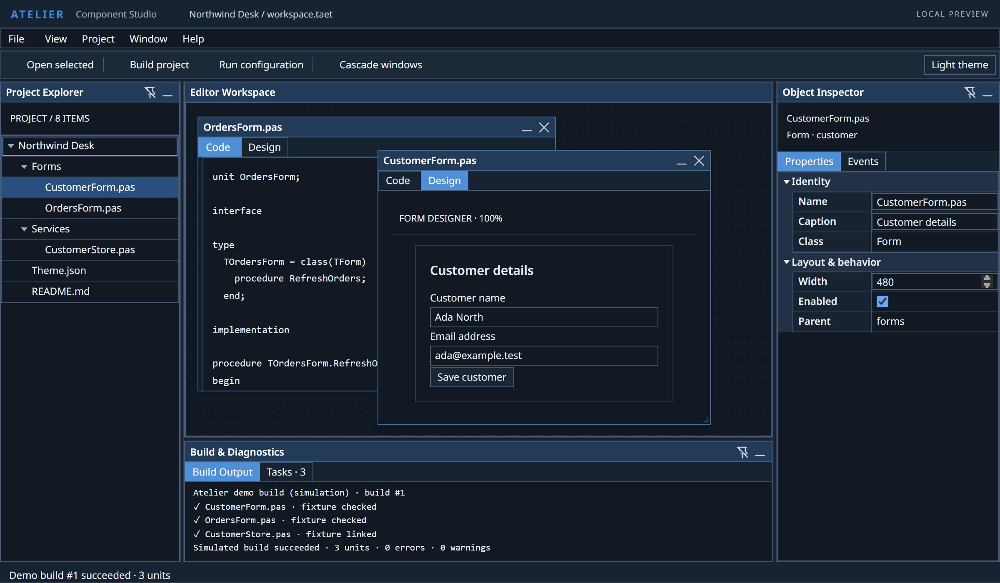
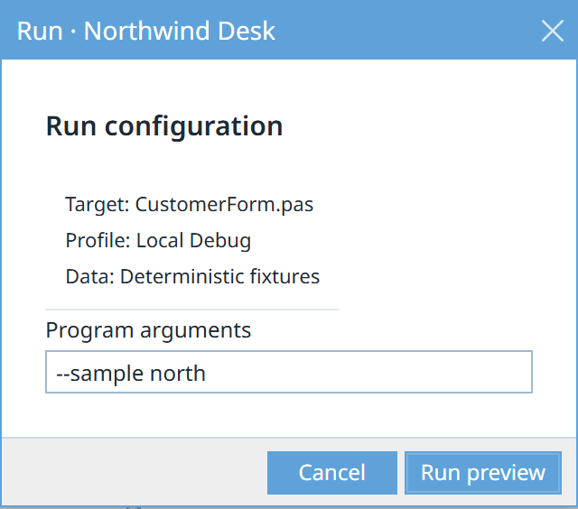

# Tæt UI

Compact desktop UI controls for embedded WebViews. Build screens with live
JavaScript objects, explicit ownership, events, commands and data models.
No JSX, virtual DOM, runtime npm dependencies or CDN.

**0.6.0-rc.6 is a pre-1.0 release candidate; published rc.3, rc.4 and rc.5 artifacts remain unchanged.** Grid/TreeGrid and Advanced remain experimental.
Source packages and standalone WebView ZIPs are separate delivery choices.
The npm preview channel uses `next`: `npm install taet-ui@next`; publication
status is recorded in the matching GitHub prerelease notes.

Display name: **Tæt UI**. Package and technical names: **taet-ui**.
Repository: [edward-ap/taet-ui](https://github.com/edward-ap/taet-ui).
See the [migration inventory](docs/TAET_MIGRATION.md) and [verification](docs/VERIFICATION.md).

## Standalone WebView distribution

`npm run distribution` builds/minifies the library and produces versioned ZIPs in
ignored `distribution/`. Release builds use `npm run distribution -- --release`
from a clean commit. GitHub prerelease assets include one ZIP for each profile:
full, components and foundation. Each contains matching CSS/fonts/licenses,
readable/minified ESM and classic IIFE JavaScript, examples, provenance and SHA-256.
Use one profile and one JS format in each document. Classic scripts expose `TaetUI`;
ESM files export named bindings. Both target ES2022 without API polyfills.

Each ZIP has a working `index.html` (classic IIFE) and `example-esm.html`. Serve
through a WebView origin or HTTP; local-file access depends on host policy.
Node/Python/npm are build/preview tools, not packaged-application dependencies.
Generated ZIPs and `dist/` stay out of Git. The npm package delivers typed ESM
source and CSS/font assets for resolver/bundler consumers.

```js
// Browser application with a resolver/bundler and its CSS loader:
import {Panel, Form, TextInput, Button} from 'taet-ui';
import 'taet-ui/taet-ui.css';
```


## Try it

Build prerequisites: Node 22+, npm and Python 3.10+ on PATH. They are development
tools; a packaged application does not need a Node/Python server. Your host
must provide a compatible system WebView runtime.

```sh
npm ci
npm run build
npm run dev
```

Open http://127.0.0.1:5173/examples/basic-form/index.html.
With that server running, also open the [workbench](http://127.0.0.1:5173/examples/grid-workbench/),
[editor matrix](http://127.0.0.1:5173/examples/grid-editors/), [Grid transfer](http://127.0.0.1:5173/examples/grid-transfer/)
and [tree movement](http://127.0.0.1:5173/examples/tree-move/).

Documentation: http://127.0.0.1:5173/docs/index.html, or run `npm run docs`
for http://127.0.0.1:5174/docs/index.html.
If a port is occupied, use `npm run dev -- --port 5641` and the corresponding URL.
In Windows PowerShell, use `npm.cmd run dev -- --port 5641` if the npm.ps1 shim
consumes forwarded options. Check `node --version`, `npm --version` and
`python --version` before starting.

## Desktop showcase

[Atelier](https://github.com/edward-ap/taet-ui/tree/main/examples/desktop-showcase) is a runnable dummy IDE made from
TreeList, DockLayout/DockPanel, MdiWorkspace, PropertyGrid, TabBar, Menu, Toolbar,
Form and Dialog. Project data and build/run actions are synthetic. These are real
controls in the same live application, captured in the built-in light/dark themes
from the rc.4 candidate.



*Light theme — the project tree selects the object inspected beside the MDI workspace.*



*Dark theme — switched on the same instance without losing edits or window state.*



*The run configuration uses a real modal Dialog and Form; fixed side placement is host CSS.*

UI composition uses live objects and explicit ownership. For example, the workspace
frame is ordinary JavaScript; the complete [example](https://github.com/edward-ap/taet-ui/tree/main/examples/desktop-showcase)
also wires selection, descriptor setters, commands, tabs and cleanup:

```js
import {DataStore} from 'taet-ui';
import {TreeList} from 'taet-ui/components';
import {DockLayout, DockPanel, MdiWorkspace} from 'taet-ui/advanced';

const records = new DataStore();
records.parse([{id: 'project', parentId: null, text: 'Demo project'}]);
const dock = new DockLayout('#desktop', {leftSize: 216, rightSize: 268});
const explorer = dock.addPanel(new DockPanel({id: 'explorer', title: 'Project', area: 'left'}));
explorer.add(new TreeList({data: records, textField: 'text'}));
const center = dock.addPanel(new DockPanel({id: 'editor', title: 'Workspace', area: 'center'}));
center.add(new MdiWorkspace({width: '100%', height: '100%'}));
const destroy = () => { dock.destroy(); records.destroy(); };
```

The host supplies data, actions and layout CSS. A WebView can serve the full ESM
profile with matching local CSS/fonts through its own origin; Node/npm are build
tools. The example explains the import map and teardown. Desktop APIs retain their
[experimental maturity](docs/STABLE_API.md); the consumer trial and its API friction
are described in the [example notes](https://github.com/edward-ap/taet-ui/tree/main/examples/desktop-showcase).

## Use it in a WebView

Copy one built profile's JS, matching CSS, `fonts/`, `LICENSE` and
`THIRD_PARTY_NOTICES.md` into your app. Full is `dist/`; subsets are
`dist/components/` and `dist/foundation/`. Use one library instance per document.
Serve modules from a WebView origin/custom protocol or HTTP. Do not assume that
opening ES modules directly through `file://` works in every host.

```html
<link rel="stylesheet" href="./taet-ui.min.css">
<body class="dui-page dui-theme-light-blue">
  <main id="app"></main>
  <script type="module" src="./app.js"></script>
</body>
```

```js
import {Panel, Form, TextInput, Button} from './taet-ui.min.js';
const name = new TextInput({name: 'name', label: 'Customer', value: 'Ada'});
const form = new Form().row(name);
form.row(new Button({text: 'Save', onClick() { console.log(form.value.get()); }}));
const screen = new Panel('#app').add(form);
export function destroy() { screen.destroy(); } // Host calls this when closing.
```

A source-only [minimal Tauri host](examples/tauri-minimal/README.md) demonstrates
a compact Form and bounded Rust echo. Its historical pre-rename Windows smoke passed
7/7 programmatic checks. The current host also builds on Apple Silicon macOS;
the maintainer exercised the native Rust echo. See the example notes for the
difference between that smoke check and full native acceptance.

For TypeScript or resolver-based apps, `npm pack --pack-destination ..` creates
the local `taet-ui-0.6.0-rc.6.tgz`. Install that file in your app with
`npm install ../taet-ui-0.6.0-rc.6.tgz`. Bare package names need a resolver or
browser import map; installing a tarball does not create native browser URLs.

| Import | Scope |
| --- | --- |
| `taet-ui/foundation` | Lifecycle, events, commands, models, validators, icons and themes |
| `taet-ui/components` | Layouts, forms, inputs, lists, tables, properties and indicators |
| `taet-ui/advanced` | MDI, docking, generic charts, mapping and theme editor |
| `taet-ui` | Stable root; legacy subpaths remain for retained APIs |
| `taet-ui/taet-ui.css` | Styles and local font |

[Architecture tiers](docs/TIERS.md) and [API maturity](docs/STABLE_API.md) are
separate. A tier name does not promote an experimental API. For changing a live
screen, read [mutation/ownership examples](docs/MUTATIONS.md).

## Preview limits

Current migration checks are recorded in [verification](docs/VERIFICATION.md).
Results apply to the recorded source revision, not automatically to older release
archives. Earlier pre-rename results identify their original inputs and are
historical evidence.

Recorded checks include Windows browser automation and a separate Windows
Tauri/WebView2 acceptance stand. Programmatic/synthetic input is distinguished
from physical input in [verification](docs/VERIFICATION.md).
On Apple Silicon macOS, the corrected source passed the full Chromium, Firefox
and WebKit suites, and the Tauri example was rebuilt with the current bundle.
The maintainer also checked documentation and Grid interactions in Safari.
Playwright WebKit is separate from a complete Safari or native WKWebView
acceptance pass. Linux native hosts, Intel/universal macOS builds, signing and
notarization remain unverified. Real IME, VoiceOver/screen-reader, native
clipboard/file-dialog and mixed-DPI acceptance remain unverified.

Grid row transfer is local and opt-in. Tree subtree movement is inside one local
tree; cross-tree copy/move and remote/custom providers are outside that contract.
Raster/Painter/StockChart/FlatFile/Spectrum/Pivot are [deferred extensions](docs/EXTENSIONS.md).

## macOS keyboard behavior

Use **Cmd** where a Grid or TreeGrid example says **Ctrl/Cmd**, including
additive row selection with Cmd-click and primary-modifier keyboard navigation.
Shift extends the selection; Ctrl-click on macOS is normally a context-menu
gesture. Browser tests use the platform primary modifier and unit tests retain
separate Ctrl and Meta coverage.

ShortcutManager treats Ctrl/Cmd/Command bindings as portable shortcuts: a
Command-key event can fall back to the Ctrl binding, while an explicit Meta
binding takes precedence. Browser- or OS-reserved shortcuts still belong to the
host; this is not a global keyboard remapping.

Safari/WebKit native Tab navigation depends on the host's keyboard-navigation
settings. Option-Tab reaches native controls when plain Tab skips them. Modal
focus containment and Grid editor commit/navigation are tested with plain
Tab and Shift-Tab; no system setting change is required by the test helper.

For contributors: [setup/checks](CONTRIBUTING.md), [AI entry point](docs/AI_CONTEXT.md),
[preview version recommendations](docs/VERSIONING.md), [changelog](CHANGELOG.md), [security](SECURITY.md).
Browser tests additionally require matching Playwright binaries; `npm ci` alone
does not install them. After npm ci, use `npx playwright install chromium firefox webkit`.
For selective Windows project flags, use the direct-node commands in
[release checks](docs/RELEASE.md). Exact remote CI and publication outcomes are
linked from the matching GitHub prerelease notes.

Tæt UI is [MIT](LICENSE). Local Noto Sans is OFL; retain its license and
[third-party notices](THIRD_PARTY_NOTICES.md) when distributing assets.
